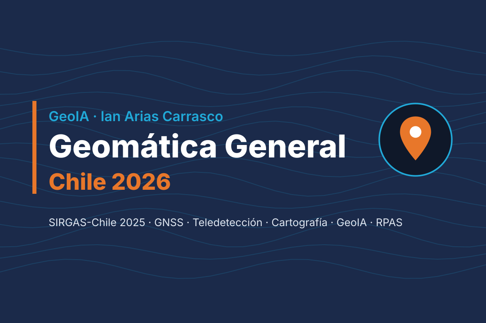

<p align="center">
  
</p>

<h1 align="center">Geomática General · Chile 2026</h1>

<p align="center">
  Libro-curso abierto de <b>geodesia, GNSS, teledetección, cartografía, IDE y GeoIA</b><br>
  con marcos de referencia, datos e instituciones de Chile.
</p>

<p align="center">
  
  
  
  
  
  
</p>

---

## 📘 ¿Qué es este repositorio?

Material docente teórico-práctico para una asignatura de **Geomática General** de nivel técnico-profesional y universitario, actualizado a **octubre de 2026** y localizado en **Chile**:

| Bloque | Contenido |
|---|---|
| **Entorno** | QGIS 4.2 LTR, ArcGIS Pro 3.7, Python + Docker, Google Earth Engine (niveles no comerciales 2026) |
| **Fundamentos** | Geomática hoy, geodesia y **SIRGAS-Chile 2025.0** (EPSG:11473), proyecciones UTM 18S/19S, GNSS multiconstelación |
| **Sensores remotos** | Física de la radiación, satélites vigentes (Landsat, Sentinel, NISAR, VIIRS), SAR, procesamiento, aplicaciones en Chile, glosario |
| **Cartografía** | Fundamentos, cartografía temática, diseño de mapas |
| **IDE y relieve** | IDE Chile / geoportal.cl, proveedores de datos, MDE (Copernicus GLO-30, SRTM, ALOS) |
| **GeoIA y RPAS** | Modelos fundacionales (Prithvi, TerraMind, AlphaEarth), SAM 3 / samgeo, fotogrametría con drones y DAN 151 |
| **Prácticas** | 10 talleres guiados con datos chilenos |
| **Proyecto final** | Estructura, rúbrica y entregables reproducibles |

## 🌐 Sitio web

Una vez activado GitHub Pages, el libro queda disponible en:
`https://ayam-arias.github.io/geoia-geomatica-general-2026`

## 🚀 Uso local

```bash
# 1. Clonar
git clone https://github.com/ayam-arias/geoia-geomatica-general-2026.git
cd geoia-geomatica-general-2026

# 2. Previsualizar el libro (requiere Quarto ≥ 1.9)
quarto preview

# 3. Entorno de Python reproducible (opcional)
docker compose -f docker/docker-compose.yml up
```

## 📂 Estructura

```
├── _quarto.yml              # Configuración del libro
├── styles/                  # Tema visual GeoIA (SCSS)
├── images/marca/            # Logo, favicon y portada
├── *.qmd                    # Capítulos, prácticas y apéndices
├── scripts/                 # Código Python / GEE de las prácticas
├── data/                    # Datos de ejemplo livianos
├── docker/                  # Dockerfile y compose del entorno
├── referencias.bib          # Bibliografía (APA 7 vía apa.csl)
└── .github/workflows/       # Publicación automática en GitHub Pages
```

## 🔁 Publicación automática

Cada `push` a `main` ejecuta `.github/workflows/publish.yml`, que renderiza el libro y lo publica en la rama `gh-pages`.
Activa: **Settings → Pages → Source: Deploy from a branch → `gh-pages` / root**.

## 📄 Licencia

- Texto, figuras propias y material docente: **[CC BY 4.0](LICENSE)**.
- Código (`scripts/`, `docker/`, bloques de código): **MIT**.
- Las obras de terceros citadas (p. ej., Chuvieco, 2020) **no se redistribuyen**; se referencian en APA 7 en el apéndice de lecturas recomendadas.

## ✍️ Autor

**Ian Arias Carrasco** — Geomático y docente · RPAS DGAC · GeoIA
[LinkedIn](https://www.linkedin.com/) · [Instagram @_geoia.n](https://www.instagram.com/_geoia.n/)

> Cómo citar: Arias Carrasco, I. (2026). *Geomática General · Chile 2026* [Libro en línea]. GitHub. https://github.com/ayam-arias/geoia-geomatica-general-2026
